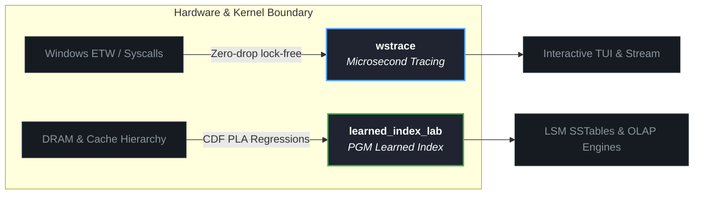

# Gilnett

  
  
  

---

### Core Engineering Focus

---

### Featured Repositories

| Project | Description | Performance Highlights |
| :--- | :--- | :--- |
| **[wstrace](https://github.com/gilnett/wstrace)** | Zero-overhead ETW tracer & system profiler | Sub-microsecond latency, lock-free ring-buffer, interactive TUI |
| **[learned_index_lab](https://github.com/gilnett/learned_index_lab)** | PGM Learned Index structure in pure Rust | **4.45x faster** than BTreeMap, **99.97% less RAM**, zero-copy range queries |

---

### Activity & Performance Metrics

  

  
  

---

<b>Detailed Benchmark Snapshot (learned_index_lab v0.2.0)</b>

 

| Structure | Hit Latency | Miss Latency | Index Memory (1M Keys) |
| :--- | :--- | :--- | :--- |
| `BTreeMap` | ~216 ns | ~61 ns | 45.78 MB |
| `slice::binary_search` | ~141 ns | ~40 ns | 0 KB (data resident) |
| **`PGM-Index`** | **~48 ns** | **~38 ns** | **12.1 KB (-99.97%)** |

