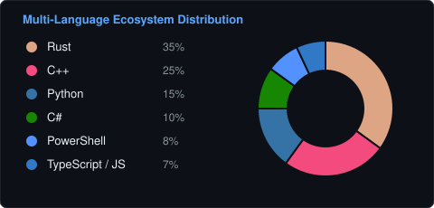

# Gilnett

  
  
  
  
  

  Computer science student & open-source developer based in Belgium. 
  Passionate about low-level systems engineering (Rust & C++), gaming, and dogs.

---

### Windows Internals & Windhawk Mods (C++ / Win32 Hooking)

Author of production mods for the [Windhawk](https://windhawk.net/) platform, focusing on low-level Win32 hooks, memory safety, and thread-safe OS tuning:

#### Published Mods:
- **[Smart Process Priority & RAM Optimizer](https://windhawk.net/mods/smart-process-priority-ram-optimizer)**: Dynamic working-set memory trimming, background CPU throttling, and intelligent priority scheduling.
- **[Taskbar Volume Percentage Indicator](https://windhawk.net/mods/taskbar-volume-percentage)**: Replaces the Windows 11 system tray volume icon with real-time master volume level percentage.
- **[Hide Taskbar Tooltips](https://windhawk.net/mods/hide-taskbar-tooltips)**: Suppresses native Windows 11 XAML hover tooltips in Explorer, with selective area filtering for taskbar apps and tray icons.

#### Upcoming Mods:
- `[Coming Soon]` **Quick Search for Windows / Explorer Search Everything**: Low-latency search injection hooking directly into Windows Explorer and the Everything search engine.

---

### Activity & Performance Metrics

  

  
  

