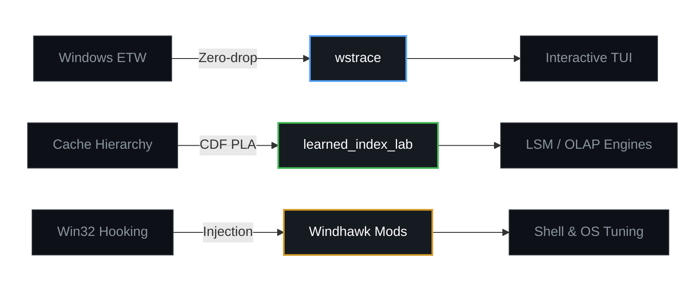

# Gilnett

  
  
  
  
  

---

### Core Engineering Focus

<!-- OPTION 1: TABLE -->
#### Option 1: Structured Table
| Project | Domain | Tech Stack | Architecture & Role |
| :--- | :--- | :--- | :--- |
| **[wstrace](https://github.com/gilnett/wstrace)** | Windows Kernel Tracing | `Rust` `ETW` `Win32` | Zero-drop microsecond event capture, lock-free ring buffer & TUI |
| **[learned_index_lab](https://github.com/gilnett/learned_index_lab)** | Learned Index Structures | `Rust` `PGM` `Eytzinger` | Mathematical CDF approximation replacing B-Trees in LSM/OLAP |
| **[Windhawk Mods](https://windhawk.net)** | Windows Internals & Tuning | `C++` `Win32 Hooking` | Thread-safe OS injection, priority scheduling & memory trimming |

<!-- OPTION 2: COMPACT MERMAID -->
#### Option 2: Compact Graph

<!-- OPTION 3: VISUAL CARDS -->
#### Option 3: Visual Cards
<table align="center" width="100%">
  <tr>
    <td width="33%" align="center" valign="top">
      <h3><a href="https://github.com/gilnett/wstrace">wstrace</a></h3>
      
<code>Rust</code> · <code>ETW</code> · <code>Kernel</code>

      
<b>Low-latency tracing</b> Zero-drop syscall & API monitor via lock-free ring buffers.

    </td>
    <td width="33%" align="center" valign="top">
      <h3><a href="https://github.com/gilnett/learned_index_lab">learned_index_lab</a></h3>
      
<code>Rust</code> · <code>PGM</code> · <code>Math</code>

      
<b>Learned Indexes</b> Mathematical CDF regressions outperforming B-Trees in CPU cache.

    </td>
    <td width="33%" align="center" valign="top">
      <h3><a href="https://windhawk.net">Windhawk Mods</a></h3>
      
<code>C++</code> · <code>Win32</code> · <code>Hooks</code>

      
<b>OS Internals Tuning</b> Thread-safe hooking, dynamic priority scheduling & RAM trimming.

    </td>
  </tr>
</table>

---

### Windows Internals & Windhawk Mods (C++ / Win32 Hooking)

Author of production mods for the [Windhawk](https://windhawk.net/) platform, focusing on low-level Win32 hooks, memory safety, and thread-safe OS tuning:

#### Published Mods:
- **[Smart Process Priority & RAM Optimizer](https://windhawk.net/mods/smart-process-priority-ram-optimizer)**: Dynamic working-set memory trimming, background CPU throttling, and intelligent priority scheduling.
- **[Taskbar Volume Percentage Indicator](https://windhawk.net/mods/taskbar-volume-percentage)**: Replaces the Windows 11 system tray volume icon with real-time master volume level percentage.
- **[Hide Taskbar Tooltips](https://windhawk.net/mods/hide-taskbar-tooltips)**: Suppresses native Windows 11 XAML hover tooltips in Explorer, with selective area filtering for taskbar apps and tray icons.

#### Upcoming Mods:
- `[Coming Soon]` **Quick Search for Windows / Explorer Search Everything**: Low-latency search injection hooking directly into Windows Explorer and the Everything search engine.

---

### Activity & Performance Metrics

  

  
  

